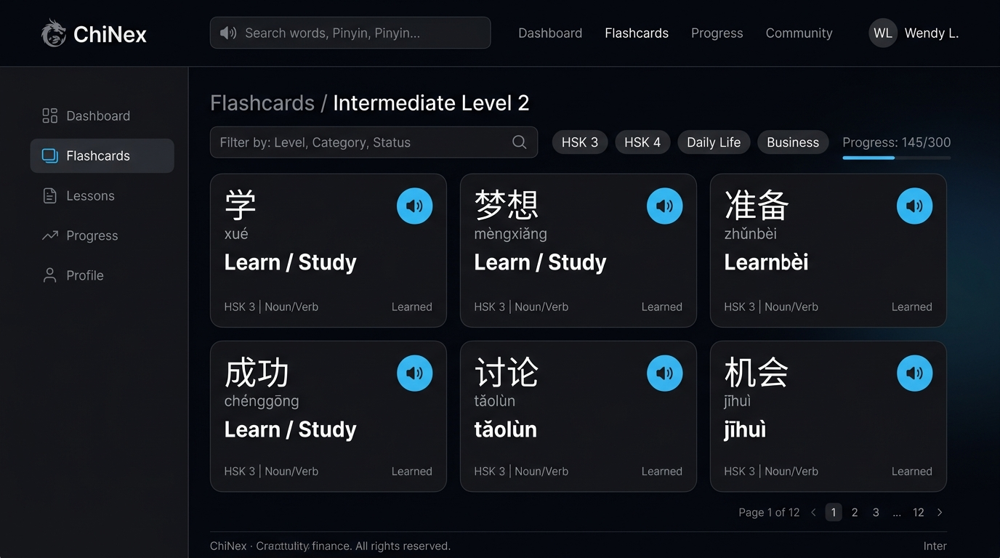

# Cao Tan Duy (YoungD) — Full Stack Developer Portfolio

<div align="center">



**Modern, Minimal, and Resilient Developer Portfolio & Technical Case Studies**

[](https://nextjs.org/)
[](https://www.typescriptlang.org/)
[](https://ant.design/)
[](https://tailwindcss.com/)
[](LICENSE)

</div>

---

## 📌 Overview

This repository contains the source code for the personal portfolio website of **Cao Tan Duy (YoungD)** — a Full Stack Developer based in Vietnam with 1+ year of hands-on experience in Frontend Development (React, Next.js, TypeScript) and modern backend systems (Node.js, Go, PostgreSQL).

Built with a **Dark-first aesthetic**, electric blue accents (`#38BDF8`), and a clean Bento Grid layout, the portfolio goes beyond simple project showcases by featuring **10-part technical case studies** that articulate architecture decisions, engineering challenges, and real-world problem-solving methodologies.

---

## ✨ Key Highlights

- ⚡ **Next.js 16 App Router & Turbopack**: Blazing-fast page loads, Server-Side Generation (SSG), and route-level optimization.
- 🎨 **Ant Design v5 + Tailwind CSS Design System**: Cohesive theme tokens via `ConfigProvider` paired with dynamic utilities, responsive Bento grids, and seamless Dark/Light theme switching.
- 📐 **In-depth Technical Case Studies**: Dynamic routing (`/projects/[slug]`) featuring 10-part software engineering case studies (ChiNex Chinese vocabulary learning PWA with Web Speech API).
- 🖼️ **Ant Design Lightbox Gallery**: Interactive image preview with mask zoom for high-resolution project screenshots.
- 🌊 **Fluid Micro-interactions (Framer Motion)**:
  - Reading progress bar (`ScrollProgressBar`) at the top of the viewport.
  - Scroll-triggered reveal animations (`ScrollReveal`, `StaggerContainer`).
  - Strict compliance with `prefers-reduced-motion` for accessibility.
- 🔍 **Technical SEO & Structured Data**:
  - OpenGraph & Twitter Card dynamic preview tags.
  - Dynamic `sitemap.xml` and `robots.txt` generation.
  - JSON-LD Structured Data Schema (`Person` & `WebSite` entities).
- ♿ **WCAG 2.2 AA Accessibility**:
  - High color contrast ratio (AAA 19.85:1).
  - Semantic HTML5 structure with unique heading hierarchy.
  - Keyboard navigation with visible focus rings (`:focus-visible`).
  - Hidden "Skip to main content" link.
  - 40x40px+ touch targets on mobile devices.

---

## 🛠️ Tech Stack

| Domain | Technologies |
| :--- | :--- |
| **Framework** | Next.js 16 (App Router), React 19 |
| **Language** | TypeScript (Strict mode) |
| **UI Component Library** | Ant Design v5/v6 (`antd`, `@ant-design/icons`, `@ant-design/nextjs-registry`) |
| **Styling** | Tailwind CSS v4, Vanilla CSS Custom Properties |
| **Animations** | Framer Motion |
| **Theme Management** | `next-themes` (Dark / Light mode with zero FOUC) |
| **Icons** | Ant Design Icons, Lucide React |
| **Package Manager** | `pnpm` (Fast, disk-efficient package manager) |

---

## 📁 Project Structure

```text
introduce/
├── docs/                        # Complete 7-phase architecture & requirements documentation
│   ├── README.md                # Master roadmap & progress tracking
│   ├── phase-1-planning.md      # Planning & Requirements
│   ├── phase-2-design-system.md # Design System & Ant Design Tokens
│   ├── phase-3-foundation.md    # Foundation & Core Layout
│   ├── phase-4-main-sections.md # Landing Page Sections
│   ├── phase-5-project-detail-pages.md # Dynamic Case Studies
│   ├── phase-6-polish.md        # Motion, SEO & Accessibility
│   └── phase-7-verification.md  # Verification & Deployment
├── implement/                   # Timestamped execution reports for each phase
├── public/                      # Static assets (images, project screenshots, resume PDF)
│   ├── images/projects/chinex/  # ChiNex cover & mockups
│   └── resume/                  # Resume PDF
├── src/
│   ├── app/                     # Next.js App Router
│   │   ├── globals.css          # Design tokens & accessibility CSS
│   │   ├── layout.tsx           # Root layout with AntdRegistry & JSON-LD
│   │   ├── page.tsx             # Main landing page
│   │   ├── robots.ts            # Dynamic robots.txt
│   │   ├── sitemap.ts           # Dynamic sitemap.xml
│   │   └── projects/[slug]/     # Dynamic Project Case Study route (SSG)
│   ├── components/              # Shared & layout components
│   │   ├── layout/              # Navbar, Footer, MobileMenu, ThemeToggle, ThemeProvider
│   │   └── shared/              # SectionHeader, ScrollProgressBar, ScrollReveal
│   ├── data/                    # Modular data sources (Profile, Skills, Projects, Experience)
│   ├── features/                # Domain-specific feature modules
│   │   ├── home/                # Hero section
│   │   ├── about/               # About Me section & pillars
│   │   ├── skills/              # Bento-grid Technical Skills section
│   │   ├── projects/            # Featured Projects & Case Study view
│   │   ├── experience/          # Experience & Education timeline
│   │   └── contact/             # Contact info & Ant Design form
│   ├── lib/                     # Utilities & custom hooks (useMounted, cn)
│   ├── styles/                  # Ant Design theme tokens (Light & Dark)
│   └── types/                   # Strict TypeScript interfaces
├── next.config.ts               # Next.js configuration (Ant Design transpilation)
├── package.json                 # Project dependencies & scripts
└── tsconfig.json                # TypeScript strict configuration
```

---

## 🚀 Getting Started

### Prerequisites

- **Node.js**: `v20.x` or `v22.x` (LTS recommended)
- **pnpm**: `v9.x` or `v10.x` (`npm install -g pnpm`)

### Installation

1. **Clone the repository:**
   ```bash
   git clone https://github.com/duycao04/introduce.git
   cd introduce
   ```

2. **Install dependencies:**
   ```bash
   pnpm install
   ```

3. **Configure Environment Variables (Optional):**
   Create a `.env.local` file in the root directory:
   ```env
   NEXT_PUBLIC_SITE_URL=https://youngd.dev
   # Optional Formspree key for contact form submission
   NEXT_PUBLIC_FORMSPREE_KEY=your_formspree_id
   ```

4. **Start the local development server:**
   ```bash
   pnpm dev
   ```
   Open [http://localhost:3000](http://localhost:3000) in your browser.

---

## 🧪 Available Scripts

| Script | Command | Purpose |
| :--- | :--- | :--- |
| **Development** | `pnpm dev` | Starts local Next.js dev server with hot reload |
| **Type Check** | `pnpm tsc --noEmit` | Validates TypeScript types across the entire project |
| **Linting** | `pnpm lint` | Runs ESLint for syntax, imports, and React Hook checks |
| **Build** | `pnpm build` | Creates an optimized production build with static pre-rendering |
| **Production Server** | `pnpm start` | Serves the production build locally |

---

## 🌐 Deployment Guide

### Option 1: Deploy on Vercel (Recommended)

1. Push your repository to GitHub: `git push origin main`.
2. Visit [Vercel](https://vercel.com) and log in with your GitHub account.
3. Click **"Add New Project"** and select the `introduce` repository.
4. **Framework Preset**: Vercel will automatically detect **Next.js**.
5. Add any environment variables (`NEXT_PUBLIC_SITE_URL`, etc.).
6. Click **Deploy**. Vercel will build and assign a global CDN URL (`*.vercel.app`).

### Option 2: Deploy on Render

1. Log in to [Render](https://render.com).
2. Click **New +** → **Web Service** and connect your GitHub repository.
3. Configure the service:
   - **Environment**: Node
   - **Build Command**: `pnpm install && pnpm build`
   - **Start Command**: `pnpm start`
4. Select the Free or Starter plan and click **Create Web Service**.

---

## 👤 Author

**Cao Tan Duy (YoungD)**
- **Role:** Full Stack Developer
- **GitHub:** [@duycao04](https://github.com/duycao04)
- **Email:** [dcao59995@gmail.com](mailto:dcao59995@gmail.com)
- **Education:** Cao Đẳng Công Thương TP.HCM (HITU)

---

## 📄 License

This project is open-source under the [MIT License](LICENSE).
